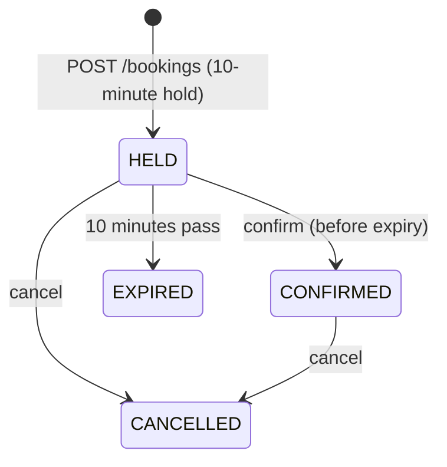
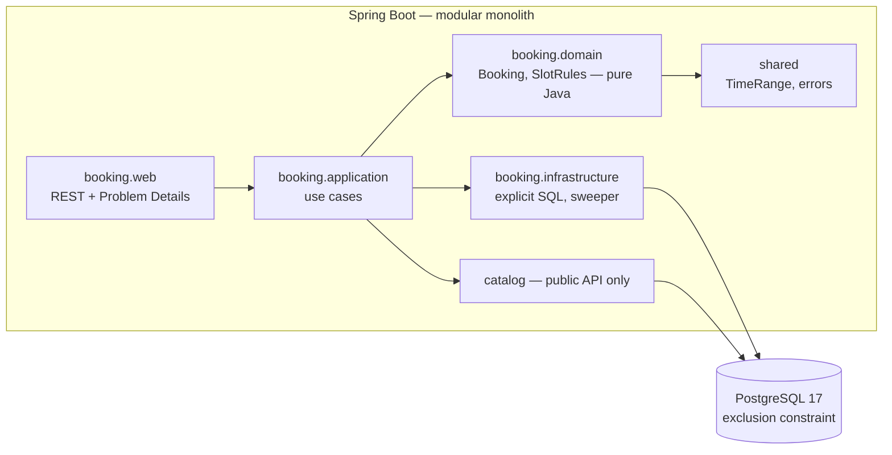

# BarberBook

Online booking for a barbershop — built to show how a senior backend engineer handles the parts that usually go wrong: **concurrency, retries, abandoned requests and module boundaries**.

    

> Built **spec-first** with [OpenSpec](https://github.com/Fission-AI/OpenSpec): every feature starts as a reviewed proposal, behavior specs, design (with rejected alternatives) and a task list — see [`openspec/`](openspec/).

## The problem

Two customers must **never** get the same barber at overlapping times — even when they click at the same instant, through different servers, retry after a timeout, or abandon a booking halfway.

A check like `if (isFree(slot)) insert(booking)` fails under concurrency: two requests both see "free" and both insert. BarberBook does not check at all. **PostgreSQL enforces the invariant**, so it holds for any number of application instances.

```sql
ALTER TABLE booking ADD CONSTRAINT booking_no_overlap
  EXCLUDE USING gist (
    barber_id WITH =,
    tstzrange(starts_at, ends_at, '[)') WITH &&    -- [) = back-to-back slots are legal
  ) WHERE (status IN ('HELD', 'CONFIRMED'));
```

| Alternative | Why it was rejected |
|---|---|
| Check-then-insert in Java | Race condition — the bug this project exists to prevent |
| `UNIQUE (barber_id, starts_at)` | Misses overlaps of different durations (10:00–11:00 vs 10:30–10:45) |
| `SELECT … FOR UPDATE` per barber | Correct, but every writer must remember to lock; a constraint cannot be forgotten |
| `SERIALIZABLE` isolation | Correct, but generic serialization failures need retry loops |
| Redis distributed lock | Extra infrastructure; lock expiry under pauses can still let two writers in |

Full reasoning: [ADR 0001](docs/adr/0001-exclusion-constraint.md) · [design.md](openspec/changes/add-slot-booking/design.md)

### Proven by tests, not by claims
`RaceConditionTest` starts **two real application instances** against one PostgreSQL and fires **20 simultaneous** bookings for the same slot: exactly **one `201`**, **nineteen `409 slot-unavailable`**, one row in the database. A **negative control** in the same class drops the constraint and runs the same race — and gets double bookings, proving the test would catch the bug.

## How a booking works



- **Holds expire without a cron dependency.** A constraint cannot use `now()`, so a new hold first expires overlapping stale holds in the same transaction (*expire-on-write*); a sweeper every 30 s updates the rest. The **database clock** is the only clock.
- **Transitions are conditional updates** — `UPDATE … WHERE status = 'HELD' AND expires_at > now()` — so *confirm* and the *sweeper* can race safely without locks.
- **Idempotent requests.** `POST /bookings` requires an `Idempotency-Key`. The key and the booking commit in the same transaction; a retry returns the original booking (`200`, `Idempotent-Replayed: true`); two concurrent requests with the same key make PostgreSQL serialize them. [ADR 0002](docs/adr/0002-idempotency-in-database.md)

## Architecture



- **Modular monolith** with Spring Modulith; a test fails the build if `booking` touches `catalog` internals. Services get extracted later only with a stated reason (roadmap #5).
- **Domain in plain Java** with an injected clock — 50+ unit tests run without a database or Spring.
- **Explicit SQL** (`JdbcClient`), not JPA: the statements that carry concurrency guarantees are visible in review.
- **Errors** follow RFC 9457 Problem Details with stable codes: `validation`, `not-found`, `slot-unavailable`, `booking-expired`, `booking-state-conflict`, `idempotency-conflict`.
- **Privacy**: customer data never reaches logs — enforced by a test that captures log output.

## Run it

Requirements: Docker. (For tests: JDK 25.)

```bash
docker compose up --build
```

- API: http://localhost:8080/api/v1 · Swagger UI: http://localhost:8080/swagger-ui/index.html
- Demo data: 3 barbers (one with a lunch break, one with days off), 4 services. PostgreSQL is exposed on port **5440**.

```bash
# What services exist?
curl -s localhost:8080/api/v1/services

# Free haircut slots with Carlos on a date (use a weekday within the next 30 days)
curl -s "localhost:8080/api/v1/availability?serviceId=11111111-0000-0000-0000-000000000001&date=2026-11-10&barberId=22222222-0000-0000-0000-000000000001"

# Hold 10:00
curl -s -X POST localhost:8080/api/v1/bookings \
  -H 'Content-Type: application/json' -H 'Idempotency-Key: try-1' \
  -d '{"barberId":"22222222-0000-0000-0000-000000000001","serviceId":"11111111-0000-0000-0000-000000000001",
       "startAt":"2026-11-10T10:00:00-03:00",
       "customer":{"name":"Maria","email":"maria@example.com","phone":"+5585999990000"}}'

# Confirm it (replace {id})
curl -s -X POST localhost:8080/api/v1/bookings/{id}/confirm
```

## Test it

```bash
./gradlew check                               # 128 tests: unit, integration, concurrency, architecture
./gradlew test --tests '*RaceConditionTest'   # just the two-instance race
```

| Level | What | Tools |
|---|---|---|
| Unit | State machine, slot fitting, grid, validation, hashing | JUnit 5, AssertJ, fixed clock |
| Integration | Constraint, expire-on-write, sweeper, idempotency, conditional updates | Testcontainers (real PostgreSQL 17 — never H2) |
| Concurrency | 20 clients × 2 instances; same-key duplicates; concurrent sweepers | Virtual threads, `CountDownLatch` |
| API | Status codes, Problem Details, OpenAPI contract | `RestTestClient` |
| Architecture | Module boundaries | Spring Modulith |

## Roadmap

| # | Change | What it adds | Status |
|---|---|---|---|
| 1 | [`add-slot-booking`](openspec/changes/add-slot-booking/proposal.md) | Availability, hold/confirm/cancel/expire, no double-booking, idempotency | ✅ Implemented |
| 2 | `add-deposit-payment` | Mercado Pago deposit, signed idempotent webhook, booking ↔ payment saga | ⏳ |
| 3 | `add-admin-auth` | Staff login with JWT + refresh tokens and roles | ⏳ |
| 4 | `add-admin-panel` | Angular admin: bookings, live search, monthly chart, Excel export | ⏳ |
| 5 | `extract-payment-service` | Payments as a separate service over gRPC | ⏳ |
| 6 | `add-aws-deployment` | Terraform: ECS Fargate, RDS, CI/CD with OIDC | ⏳ |

## Repository layout

```
src/main/java/io/barberbook/
├── shared/      TimeRange, ProblemType, Problem Details handler, correlation id
├── catalog/     barbers, services, weekly schedules (public API + internal SQL)
└── booking/     domain (pure) · application (use cases) · infrastructure (SQL, jobs) · web (REST)
src/main/resources/db/
├── migration/   V1 catalog · V2 booking + exclusion constraint · V3 idempotency keys
└── seed/        demo data (local profile only)
openspec/        config, specs and the change that produced this code
docs/adr/        architecture decision records
```
