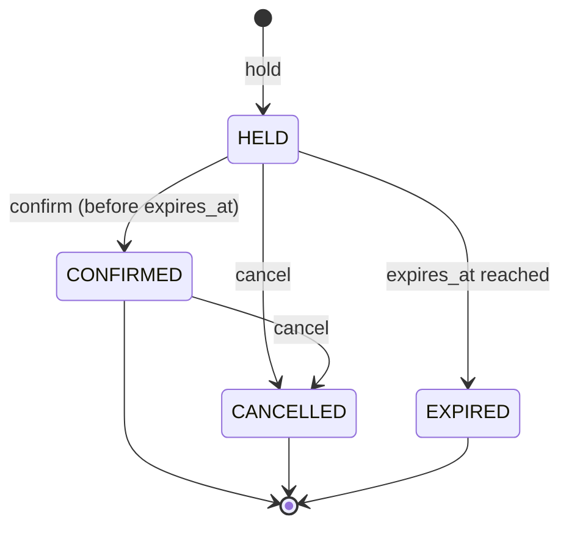

# Design

## Context

Greenfield repository. See `proposal.md` for motivation and scope, and the three specs for the required behavior. The hard part of this change is not CRUD: it is keeping the **no-double-booking** invariant true under concurrency, retries and abandoned holds, while keeping the domain testable without a database.

## Goals / Non-Goals

**Goals:**
- The invariant lives in PostgreSQL, so it holds with any number of application instances.
- Domain rules (state transitions, slot fitting) are plain Java, unit-tested with an injected `Clock`.
- Every concurrency and failure scenario in the specs has an automated test.
- Module boundaries are enforced by a test, not by convention.

**Non-Goals:**
- Performance tuning beyond correct indexes; one shop does not need caching.
- Multi-shop (multi-tenant) support.
- Authentication (see `add-admin-auth`).

## Decisions

### D1. Modular monolith with Spring Modulith
Two application modules, `catalog` and `booking`, plus `shared` (time, errors). `booking` may call `catalog` only through its public API package. A Spring Modulith verification test fails the build on any illegal dependency.

- *Microservices now* — rejected: no problem yet that distribution solves; it would add network failure modes before the domain is stable. Extraction is planned in `extract-payment-service`, with a stated reason.
- *Single package, no boundaries* — rejected: boundaries are what make the later extraction cheap.

### D2. Layers inside `booking`
`domain` (aggregate `Booking`, value objects `TimeRange`, `BookingStatus`, no Spring imports) → `application` (use cases: `HoldSlot`, `ConfirmBooking`, `CancelBooking`, `QueryAvailability`) → `infrastructure` (SQL adapters, scheduler) and `web` (REST controllers, DTOs).

- *Full hexagonal with ports for everything* — rejected: ports only where there are two real implementations or a test seam (the clock and the booking repository).

### D3. Persistence with Spring `JdbcClient` and explicit SQL
Every statement is explicit SQL through Spring's `JdbcClient`, mapped to records by hand. The critical ones (hold, confirm, expire) are where the concurrency guarantees live, so they must be visible in code review, not generated.

- *JPA/Hibernate* — rejected: flush timing hides **when** the constraint fires, making it harder to map a violation to a 409 deterministically; lazy loading adds no value for small aggregates.
- *Spring Data JDBC* — considered first and dropped during implementation: aggregates here are one table each, and every write that matters is a custom conditional statement anyway, so the repository abstraction added mapping rules without removing code.
- *jOOQ* — rejected for now: extra code generation step; plain SQL is enough for a handful of statements.

### D4. No-double-booking enforced by an exclusion constraint
```sql
CREATE EXTENSION IF NOT EXISTS btree_gist;

ALTER TABLE booking ADD CONSTRAINT booking_no_overlap
  EXCLUDE USING gist (
    barber_id WITH =,
    tstzrange(starts_at, ends_at, '[)') WITH &&
  ) WHERE (status IN ('HELD', 'CONFIRMED'));
```
`[)` (inclusive start, exclusive end) is what makes back-to-back bookings legal. A violation (`SQLSTATE 23P01`) is translated to `409 slot-unavailable`.

| Alternative | Why rejected |
|---|---|
| Check-then-insert in Java | Race: two requests both see "free", both insert. This is exactly the bug the project exists to show. |
| `UNIQUE (barber_id, starts_at)` | Only catches identical starts; 10:00–11:00 and 10:30–10:45 still overlap. |
| `SELECT … FOR UPDATE` on the barber row | Correct, but serializes all writes per barber and relies on **every** writer remembering to lock. The constraint cannot be forgotten. |
| `SERIALIZABLE` isolation | Correct, but turns conflicts into generic serialization failures that need retry loops and are harder to explain to the client. |
| Redis distributed lock | Extra infrastructure, and lock expiry under GC pauses or network issues can still allow two writers. The database is already the source of truth. |

### D5. Expiration without a time-dependent constraint
A constraint predicate cannot use `now()`, so an expired-but-not-yet-swept `HELD` row would still block the slot. Two mechanisms close the gap:

1. **Expire-on-write**: in the same transaction as a new hold, before the insert, expire overlapping holds of that barber whose `expires_at <= now()`. This satisfies "slot reusable exactly at expiration".
2. **Sweeper**: a scheduled job every 30 s runs `UPDATE booking SET status = 'EXPIRED' WHERE status = 'HELD' AND expires_at <= now()`. It is idempotent, so running it on several instances at once is harmless and needs no distributed lock. This satisfies "marked EXPIRED within one minute".

**Database time is the authority**: `expires_at` is set with `now() + interval '10 minutes'` in SQL, and every comparison uses `now()`. Application clocks on different hosts can drift; the database clock is one clock.

### D6. State transitions as conditional updates

The domain object decides whether a transition is allowed (unit-tested), and the SQL makes it atomic:
`UPDATE booking SET status = 'CONFIRMED', expires_at = NULL WHERE id = ? AND status = 'HELD' AND expires_at > now()`.
Zero rows updated means the booking expired or changed concurrently; the use case reloads it and returns the correct error. This removes the race between **confirm** and the **sweeper** without locks.

### D7. Idempotency keys stored with the booking, in one transaction
Table `idempotency_key(key PK, request_hash, booking_id, created_at)`. The hold use case inserts the key and the booking in the same transaction.

```mermaid
sequenceDiagram
    participant C as Client
    participant A as API
    participant DB as PostgreSQL
    C->>A: POST /bookings (Idempotency-Key: k1)
    A->>DB: BEGIN; INSERT idempotency_key(k1, hash) ; expire-on-write ; INSERT booking ; COMMIT
    A-->>C: 201 booking b1
    Note over C,A: response lost, client retries
    C->>A: POST /bookings (Idempotency-Key: k1)
    A->>DB: INSERT idempotency_key(k1) → unique violation
    A->>DB: SELECT booking_id, request_hash WHERE key = k1
    A-->>C: 200 booking b1 (same hash) / 422 idempotency-conflict (different hash)
```
- Two concurrent requests with the same key: PostgreSQL makes the second insert **wait** for the first transaction, then fail on the unique key. No double processing and no extra locking code.
- A failed hold (e.g. `409`) rolls back the key too, so a retry is evaluated again. That is correct: the slot may have become free.
- `request_hash` is SHA-256 of the canonical request body. Keys are purged after 48 h (spec requires at least 24 h).

- *Idempotency in Redis* — rejected: the key and the booking would no longer commit atomically.

### D8. Availability computed in memory, per request
Load the barber's working intervals for the weekday and the active bookings for that local day (one indexed query), generate 15-minute candidates, and drop those that do not fit or overlap. With at most ~40 candidates per barber per day there is nothing to optimize. The result is advisory (see spec), so default `READ COMMITTED` is enough.

### D9. Time handling
`timestamptz` columns, `Instant` in the domain, `OffsetDateTime` in the API, converted with the shop `ZoneId` (`America/Fortaleza`). Local dates are converted to UTC ranges through the `ZoneId`, never by hard-coding `-03:00`, so a future shop in a zone with daylight saving still works.

### D10. API contract and errors
REST under `/api/v1`, documented with OpenAPI. Errors use **RFC 9457 Problem Details** with stable `type` values: `slot-unavailable` (409), `booking-expired` (409), `booking-state-conflict` (409, e.g. confirming a cancelled booking), `idempotency-conflict` (422), `validation` (400), `not-found` (404). Booking ids are random UUIDs (v4): unguessable, which matters because there is no authentication yet.

### D11. Observability and privacy
Structured JSON logs (Spring Boot structured logging). A filter puts a correlation id (`X-Request-Id`, generated when absent) in the MDC. Customer fields are excluded from `toString()` and never logged; a test captures log output during a failed hold and asserts that no customer data appears.

### D12. Test strategy
| Level | Tool | Covers |
|---|---|---|
| Unit | JUnit 5, AssertJ, fixed `Clock` | State machine, `TimeRange` overlap, slot fitting, grid alignment |
| Integration | Testcontainers PostgreSQL 17 | Exclusion constraint, expire-on-write, sweeper, idempotency, conditional updates |
| Concurrency | Two Spring Boot instances on random ports + 20 virtual threads behind a `CountDownLatch` | "Race for the same slot" scenario |
| Architecture | Spring Modulith `verify()` | Module boundaries |
| API | `MockMvc` / `RestClient` | Status codes and Problem Details bodies |

Virtual threads are enabled (`spring.threads.virtual.enabled=true`): request handling is I/O-bound and the concurrency test benefits from cheap threads.

## Risks / Trade-offs

- [Exclusion constraints are PostgreSQL-specific] → Accepted: the invariant is worth more than database portability. Documented in the README.
- [Expire-on-write adds an `UPDATE` to every hold] → It touches only overlapping rows of one barber and uses the same index as the constraint.
- [Sweeper runs on every instance] → The update is idempotent; duplicate runs cost a no-op query. Revisit with a scheduler lock only if it shows up in metrics.
- [No authentication: anyone with a booking id can cancel it] → Ids are unguessable random UUIDs, and the API is not deployed publicly in this change. Customer-side tokens or auth are a later change.
- [Concurrency test is timing-sensitive] → It asserts on the final database state (exactly one active row) and on the response count, not on timing.

## Migration Plan

Greenfield: Flyway `V1__catalog.sql`, `V2__booking.sql` (including `btree_gist` and the constraint), `V3__idempotency.sql`. Demo data (one shop, 3 barbers, 4 services, working hours) lives in a separate Flyway location enabled only in the `local` profile, so tests and future production never receive seed data. Rollback: drop the database; nothing is deployed yet.

## Open Questions

- Deposit amount and refund policy on cancellation: decided in `add-deposit-payment`; it does not change this change's states.
- Minimum notice for cancelling a confirmed booking: product decision for a later change; today any confirmed booking can be cancelled.
